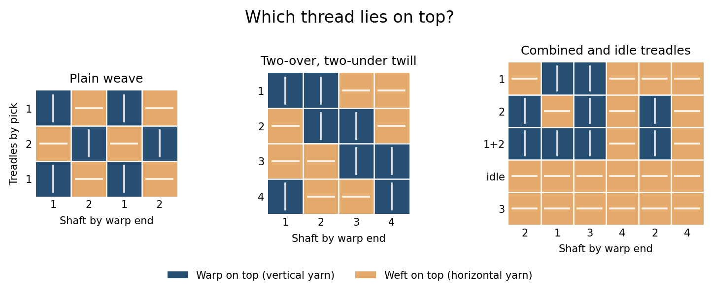

# Tree-ring alignment, loom drawdown and knot coloring

On a Kaggle Tesla T4, three hand-programmed transformers matched their independent references on **768/768 complete held-out records** and **91,392/91,392 individual labels**. At sizes above the development range, 384/384 complete records matched. The separate worked checks passed on 13/13 inputs.

## Accuracy and timing by input size

| Application | Size | Stored FP32 coefficients | Exact records | Correct labels | Median GPU time (ms) |
| --- | --- | --- | --- | --- | --- |
| Tree-ring alignment | 12 | 11 | 64/64 | 320/320 | 6.64 |
| Tree-ring alignment | 16 | 11 | 64/64 | 576/576 | 6.48 |
| Tree-ring alignment | 24 | 11 | 64/64 | 1,088/1,088 | 6.41 |
| Tree-ring alignment | 40 | 11 | 64/64 | 2,112/2,112 | 6.32 |
| Loom drawdown | 4 | 4 | 64/64 | 1,024/1,024 | 3.30 |
| Loom drawdown | 8 | 4 | 64/64 | 4,096/4,096 | 3.44 |
| Loom drawdown | 16 | 4 | 64/64 | 16,384/16,384 | 3.46 |
| Loom drawdown | 32 | 4 | 64/64 | 65,536/65,536 | 3.90 |
| Fox 3-colorings | 4 | 50 | 64/64 | 64/64 | 7.21 |
| Fox 3-colorings | 8 | 50 | 64/64 | 64/64 | 11.02 |
| Fox 3-colorings | 16 | 50 | 64/64 | 64/64 | 17.33 |
| Fox 3-colorings | 32 | 50 | 64/64 | 64/64 | 29.84 |

Size counts rings in the reference series, warp ends and picks per side of a square draft, or signed crossings in a braid word. One exact record requires every candidate start, every cloth crossing, or the single coloring count to agree. A longer reference adds possible alignments for the same eight-ring sample. Doubling a square draft’s side quadruples its output area. A longer braid requires additional sequential updates to the three-strand colors.

Each timing is the median of 3 synchronized forward sweeps over 64 FP32 records on the GPU, in batches of 8 after warm-up. Encoding, transfers, decoding and scoring occur outside the timer. Stored coefficients include zeros and count shared weights once. The fixed wiring and intermediate arrays also contribute to the computation. [All timing repeats](sizes.csv)

## Dendrochronology · matching ring-width changes

An eight-ring sample contributes up to seven one-year changes. A change qualifies when both series have measured endpoints and both widths changed. For each offset with at least four qualifying changes, the score is the fraction that agree in direction. The transformer returns all offsets tied for the best score. The worked cases below use relative offsets measured from the oldest reference ring.

| Check | Best offsets (zero-based) | Agreements / usable intervals at each best offset | Insufficient offsets |
| --- | --- | --- | --- |
| Scaled extract | 2 | 7/7 | none |
| Tie with missing years | 2, 4 | 5/5, 7/7 | 0 |
| Weak unique match | 0 | 1/7 | none |
| Too few intervals | none | — | 0, 1, 2 |

The model matched 130/130 records with a unique best start, 90/90 with tied starts, and 36/36 with insufficient evidence at every start. The weak worked example has a single winner with only one agreement in seven. Real calendar dating requires independent material and corroboration.

In 56 held-out records, exactly one complete reference window reproduces the eight sample widths by multiplying each width by 1 or 2 and then adding a single integer from 1 to 29. That offset was among the predicted best starts in 56/56 such records. It was the only predicted winner in 45/56. Repeated rise/fall patterns can tie even when the complete width sequence identifies a single window. [Runnable ring sample](../../atlas/examples/rings.json)

## Textile engineering · drawing the cloth from a loom draft



Across each panel the tick labels identify the shafts carrying the warp ends. Reading down the side gives the treadles pressed for each pick. In the right panel, pressing treadles 1 and 2 together raises shafts 1, 2 and 3. The following idle pick exposes the weft across the full width.

The model matched 129/129 drafts containing a simultaneous treadle press and 127/127 drafts without one. Keeping only the first pressed treadle in each pick would change the cloth in 114 held-out drafts. The model matched 114/114 of those drafts exactly. These are binary interlacements on the upper face of an ideal rising-shed loom. The drawdown gives the order of the threads at a crossing. Color, thickness and tension determine the finished appearance. [Runnable twill draft](../../atlas/examples/loom.json)

## Knot theory · counting Fox 3-colorings

Each signed generator crosses two adjacent strands. Closing the braid joins each bottom endpoint to the top endpoint in the same position. A Fox coloring assigns one of three colors to each arc and satisfies the crossing rule that twice the overstrand color equals the sum of the two understrand colors modulo three. The model counts all assignments that close, including three constant colorings.

| Closure | Signed braid word | GPU colorings |
| --- | --- | --- |
| Three separate circles | `[]` | 27 |
| Unknot | `[1, 2]` | 3 |
| Trefoil | `[1, 1, 1, 2]` | 9 |
| Figure-eight knot | `[1, -2, 1, -2]` | 3 |
| Grouped generators | `[1, 1, 2, 2]` | 3 |
| Alternating generators | `[1, 2, 1, 2]` | 9 |

In the held-out set the model matched 81/81 closures with 3 colorings, 108/108 with 9, and 67/67 with 27. The trefoil has six nonconstant colorings. The unknot and figure-eight knot both have just the three constant ones, so this count can be shared by distinct knots. The model enumerates 27 top-strand assignments and advances them through each crossing using the same weights. The independent audit derives one modular equation per crossing and solves the closure system by row reduction. [Runnable trefoil](../../atlas/examples/braid.json)

## Run and verify

[Model guide and commands](../../atlas/README.md) · [Frozen protocol](../../atlas/protocol.json) · [Named check inputs and labels](../../atlas/checks.json) · [Independent audit](audit.json) · [Archived GPU predictions](../../kaggle/runs/atlas/v1/output/atlas-predictions.npz) · [Submission receipt](../../kaggle/runs/atlas/v1/submission.json) · [GPU verification](../../kaggle/runs/atlas/v1/verification.json) · [Private Kaggle run](https://www.kaggle.com/code/ajayasaithambi/loopedwsp-rings-loom-and-braids/versions/1)

```sh
python atlas/experiment.py predict rings --example
python atlas/experiment.py predict loom --example
python atlas/experiment.py predict braid --example
python atlas/audit.py kaggle/runs/atlas/v1 audit-output/atlas-audit.json
python atlas/report.py kaggle/runs/atlas/v1 results/atlas
```
