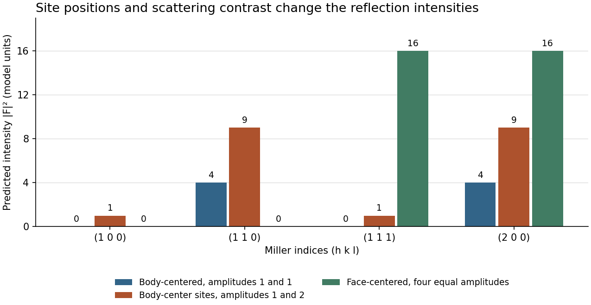

# Turkish morphology, crystal diffraction and auction pricing

On a Kaggle Tesla T4, three hand-programmed transformers matched their independent references on **768/768 complete held-out records** and 8,960/8,960 individual output labels. At input sizes above the development range the models matched **384/384 records**. The separate named check set matched on 8/8 inputs. Those checks are excluded from accuracy totals and timing.

## Accuracy and runtime by input size

| Application | Size | Stored FP32 coefficients | Exact records | Correct labels | Median ms |
| --- | --- | --- | --- | --- | --- |
| Turkish noun inflection | 2 | 449 | 64/64 | 256/256 | 6.57 |
| Turkish noun inflection | 4 | 449 | 64/64 | 512/512 | 6.92 |
| Turkish noun inflection | 8 | 449 | 64/64 | 1,024/1,024 | 6.94 |
| Turkish noun inflection | 16 | 449 | 64/64 | 2,048/2,048 | 6.94 |
| Crystal diffraction | 4 | 43 | 64/64 | 256/256 | 5.42 |
| Crystal diffraction | 8 | 43 | 64/64 | 512/512 | 5.64 |
| Crystal diffraction | 16 | 43 | 64/64 | 1,024/1,024 | 5.61 |
| Crystal diffraction | 32 | 43 | 64/64 | 2,048/2,048 | 6.03 |
| Combinatorial auction | 2 | 6 | 64/64 | 128/128 | 5.02 |
| Combinatorial auction | 4 | 6 | 64/64 | 256/256 | 5.38 |
| Combinatorial auction | 6 | 6 | 64/64 | 384/384 | 5.26 |
| Combinatorial auction | 8 | 6 | 64/64 | 512/512 | 5.33 |

Size counts noun requests, Miller-index reflections or bidders per record. An exact record requires both suffixes for every noun, every intensity in the reflection list or every bidder’s winner and payment status. Longer noun and reflection lists contain more independent queries. More bidders increase the number of possible allocations. Each time is the median of three synchronized FP32 forward passes over 64 GPU-resident records in batches of eight after a warm-up. Encoding, transfers and scoring occur outside the timer. Stored coefficient counts include zeros and count shared weights once. Fixed input features, masks and working memory are excluded. [Individual repeats](sizes.csv)

## Linguistics · inflecting regular Turkish nouns

The held-out generator combines regular nonce stems with number and case requests. The model predicted both suffixes correctly for 1,920/1,920 requests covering 1,850 distinct stems and 1,910 distinct surface forms. The formatter copies the supplied lowercase stem and appends the predictions. In the separate real-word check below, the stated number and case select one surface form per row.

| Stem | Requested number | Requested case | GPU form |
| --- | --- | --- | --- |
| kapı | singular | genitive | kapının |
| kedi | singular | accusative | kediyi |
| göl | plural | accusative | gölleri |
| gül | plural | locative | güllerde |
| kuş | singular | ablative | kuştan |
| otobüs | singular | locative | otobüste |
| ev | singular | ablative | evden |
| yol | plural | genitive | yolların |
| ev | singular | accusative | evi |
| at | plural | nominative | atlar |
| masa | singular | accusative | masayı |
| göl | singular | genitive | gölün |

The plural suffix can supply the vowel governing the following case suffix, as in *göl → göl-ler-i*. Consonant assimilation selects *-tan* in *kuştan*. The study covers unchanged common-noun stems with regular harmony and five cases. Stem alternations, exceptional harmony, possessives and proper names are outside its input contract. [Runnable inflection example](../../crossfield/examples/inflection.json)

## Crystallography · predicting reflection intensity



| Motif | Reflections in query order | GPU intensities |
| --- | --- | --- |
| Body-centered, amplitudes 1 and 1 | (1 0 0), (1 1 0), (1 1 1), (2 0 0) | 0, 4, 0, 4 |
| Body-center sites, amplitudes 1 and 2 | (1 0 0), (1 1 0), (1 1 1), (2 0 0) | 1, 9, 1, 9 |
| Face-centered, four equal amplitudes | (1 0 0), (1 1 0), (1 1 1), (2 0 0) | 0, 0, 16, 16 |
| Quarter-cell offset, amplitudes 2 and 1 | (1 0 0), (-1 0 0), (2 0 0), (4 0 0) | 5, 5, 1, 9 |

The model matched 1,102/1,102 canceled reflections and 2,738/2,738 nonzero reflections. Both members were exact in 305/305 opposite-index pairs counted within records. In the first two-site example, the two (1 0 0) contributions have opposite phase and cancel. Changing the center amplitude from 1 to 2 leaves intensity 1 at the same reflection. The quarter-cell example also exercises imaginary amplitudes. These are ideal kinematical intensities from fixed real point amplitudes on a quarter-cell grid. Assigning a space group or predicting measured detector counts requires additional information. [Runnable diffraction example](../../crossfield/examples/diffraction.json) · [IUCr definition](https://dictionary.iucr.org/Structure_factor)

## Market design · allocating bundles and computing externality payments

| Auction | Bundle bids in order | GPU outcomes in order | Total winning value |
| --- | --- | --- | --- |
| Two specialists and a bundle bid | AB for 10, A for 7, B for 6 | loses · wins (pays 4) · wins (pays 3) | 13 |
| Disjoint requests | A for 12, BCD for 4 | wins (pays 0) · wins (pays 0) | 16 |
| Identical single-item bids | C for 6, C for 6 | wins (pays 6) · loses | 6 |

The two specialist bids together yield 13 units of reported value. With the A bidder removed, the best remaining allocation is the 10-unit bundle. With A present, the other winner receives a bundle valued at 6, so the A bidder pays 4. The B bidder pays 3 by the same rule. A winner can pay zero when their participation imposes no cost on other bidders. Equal-welfare allocations use the smaller winner bit mask, where the first bidder has the least significant bit.

Across the held-out auctions, the model matched 52/52 records where taking bids greedily in descending order loses welfare and 101/101 records with multiple welfare-maximizing allocations. It identified 149/149 zero-price winners. Each bidder requests one bundle of the four available items. The implementation allocates one attention-memory slot per bidder subset, up to 256 slots for eight bidders. [Runnable auction example](../../crossfield/examples/auction.json)

## Run and verify

[Models, input bounds and worked examples](../../crossfield/README.md) · [Frozen protocol](../../crossfield/protocol.json) · [Named check inputs and expected answers](../../crossfield/checks.json) · [Independent regrading](audit.json) · [Raw predictions](../../kaggle/runs/crossfield/v1/output/crossfield-predictions.npz) · [Submission receipt](../../kaggle/runs/crossfield/v1/submission.json) · [GPU verification](../../kaggle/runs/crossfield/v1/verification.json) · [Private Kaggle run](https://www.kaggle.com/code/ajayasaithambi/loopedwsp-crossfield-applications/versions/1)

The examples use NumPy and PyTorch. Regenerating the figure also requires Matplotlib.

```sh
python crossfield/experiment.py predict inflection --example
python crossfield/experiment.py predict diffraction --example
python crossfield/experiment.py predict auction --example
python crossfield/audit.py kaggle/runs/crossfield/v1 audit-output/crossfield-audit.json
python crossfield/report.py kaggle/runs/crossfield/v1 results/crossfield
```
