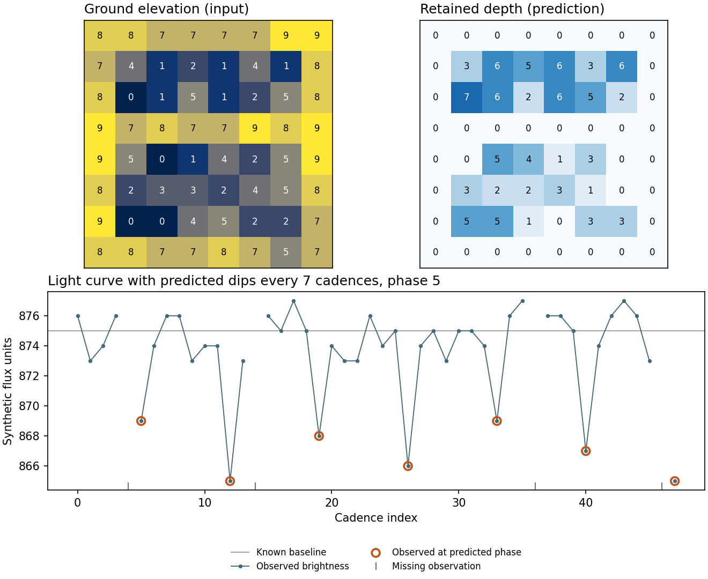

# Hydrology, astronomy and ten-pin scoring

The frozen models matched their task references on **768/768 complete records** and 18,560/18,560 individual outputs on a Kaggle Tesla T4. At sizes larger than the development range they matched 384/384 records. For astronomy, the reference is an explicitly defined template search. The injected-signal recovery table below measures a separate outcome.

## Accuracy and runtime by size

| Application | Size | Stored parameters | Exact records | Correct labels | Median ms |
| --- | --- | --- | --- | --- | --- |
| Terrain depression filling | 4 | 6 | 64/64 | 1,024/1,024 | 9.12 |
| Terrain depression filling | 6 | 6 | 64/64 | 2,304/2,304 | 22.98 |
| Terrain depression filling | 8 | 6 | 64/64 | 4,096/4,096 | 48.61 |
| Terrain depression filling | 12 | 6 | 64/64 | 9,216/9,216 | 112.67 |
| Transit-template search | 24 | 12 | 64/64 | 64/64 | 5.63 |
| Transit-template search | 48 | 12 | 64/64 | 64/64 | 5.43 |
| Transit-template search | 96 | 12 | 64/64 | 64/64 | 6.09 |
| Transit-template search | 192 | 12 | 64/64 | 64/64 | 5.63 |
| Ten-pin scorekeeping | 3 | 7 | 64/64 | 192/192 | 14.37 |
| Ten-pin scorekeeping | 5 | 7 | 64/64 | 320/320 | 16.96 |
| Ten-pin scorekeeping | 8 | 7 | 64/64 | 512/512 | 16.65 |
| Ten-pin scorekeeping | 10 | 7 | 64/64 | 640/640 | 18.72 |

Size counts cells per side, brightness samples or started bowling frames. One record requires every output to be correct, including pending bowling scores. Times are the medians of three synchronized forward passes over 64 GPU-resident records in batches of eight after warm-up, excluding encoding, transfers and scoring. Parameter counts include stored zeros and count shared tensors once. The counts exclude fixed features, geometry and working memory. [All timing repeats](sizes.csv)

## Terrain and telescope examples



The 8×8 raster is test record `basin_8[31]`. Its predicted depths sum to **98 cell-height units**. The light curve is `transit_48[0]`. The recovered period and phase match its injected values. The charts illustrate individual records.

With an open perimeter and four-neighbor flow, the basin model matched the complete depth grid on 223/223 terrains where using only immediate neighbors gives a different answer. The target is depression storage under the stated drainage assumptions. The experiment uses integer elevations and unit-area cells.

## Did the search recover the injected transit?

| Cadences | Injected | Period + phase recovered | No candidate | Wrong template | Uninjected | False alarms |
| --- | --- | --- | --- | --- | --- | --- |
| 24 | 32 | 13 | 16 | 3 | 32 | 0 |
| 48 | 32 | 22 | 2 | 8 | 32 | 0 |
| 96 | 32 | 24 | 0 | 8 | 32 | 0 |
| 192 | 32 | 24 | 0 | 8 | 32 | 0 |
| All | 128 | 83 | 18 | 27 | 128 | 0 |

Recovery requires both the injected period and the zero-based phase. A wrong template is a detection at another period or phase. In 27/27 wrong-template cases, the selected and injected templates mark exactly the same observed cadences. A false alarm is a detection on a series with no injected periodic signal. For each series the model and reference receive only the known baseline and measured flux. The experiment uses one-cadence synthetic dips, missing measurements and a bank of five integer trial periods. Its recovery rates describe this generator.

In test record `transit_24[4]`, the injected period 9, phase 4, and the selected period 3, phase 1, both predict dips at precisely the observed indices 4, 13, 22. Both score 15. The tie rule selects the shorter period.

## Live bowling scorecard

The GPU returned this scorecard for `bowling_5[1]`. Each pending entry awaits another legal delivery.

| Frame | Pins on each ball | Cumulative score |
| --- | --- | --- |
| 1 | 8, 2 | 20 |
| 2 | 10 | 35 |
| 3 | 5, 0 | 40 |
| 4 | 10 | 60 |
| 5 | 3, 7 | Pending |

Across all sizes, the rule-based reference had 147 cards with at least one pending cumulative score. The model matched all entries on 147 of them. The test includes 32 completed ten-frame games.

## Run and verify

The repository contains the JSON examples, domain-specific input rules, programmed weights and an independent scorer that recomputes every target. [Example commands and methods](../../fieldlab/README.md) · [Frozen protocol](../../fieldlab/protocol.json) · [Raw predictions](../../kaggle/runs/fieldlab/v1/output/fieldlab-predictions.npz) · [Independent audit](audit.json) · [Kaggle receipt](../../kaggle/runs/fieldlab/v1/verification.json) · [Private Kaggle run](https://www.kaggle.com/code/ajayasaithambi/loopedwsp-field-experiments/versions/1)

```sh
python fieldlab/experiment.py predict bowling --input fieldlab/examples/bowling.json
python fieldlab/audit.py kaggle/runs/fieldlab/v1 audit-output/fieldlab-audit.json
python fieldlab/report.py kaggle/runs/fieldlab/v1 results/fieldlab
```
