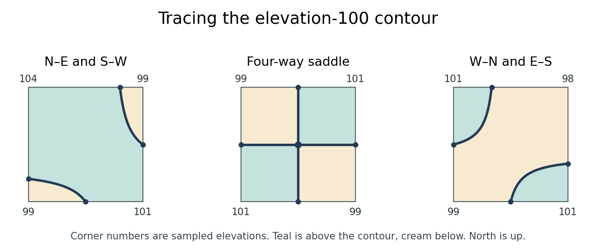

# Contour connectivity, ancestral plumage and Clifford measurement outcomes

Three hand-programmed transformers matched their independent references on **768/768 complete held-out records** on a Kaggle Tesla T4. They matched **53,312/53,312 individual outputs** and 384/384 complete records at sizes above the development range. The separate worked checks passed on 13/13 inputs.

## Accuracy and runtime by size

| Application | Size | Stored FP32 coefficients | Exact records | Correct labels | Median GPU time (ms) |
| --- | --- | --- | --- | --- | --- |
| Contour connectivity | 3 | 54 | 64/64 | 576/576 | 7.76 |
| Contour connectivity | 6 | 54 | 64/64 | 2,304/2,304 | 8.22 |
| Contour connectivity | 12 | 54 | 64/64 | 9,216/9,216 | 8.59 |
| Contour connectivity | 24 | 54 | 64/64 | 36,864/36,864 | 7.97 |
| Ancestral plumage | 4 | 5 | 64/64 | 192/192 | 13.72 |
| Ancestral plumage | 8 | 5 | 64/64 | 448/448 | 22.91 |
| Ancestral plumage | 12 | 5 | 64/64 | 704/704 | 32.41 |
| Ancestral plumage | 16 | 5 | 64/64 | 960/960 | 41.11 |
| Clifford measurements | 4 | 1025 | 64/64 | 512/512 | 11.73 |
| Clifford measurements | 8 | 1025 | 64/64 | 512/512 | 19.94 |
| Clifford measurements | 16 | 1025 | 64/64 | 512/512 | 33.07 |
| Clifford measurements | 32 | 1025 | 64/64 | 512/512 | 79.67 |

Size counts cells on each side of the square map, observed tips of a rooted tree, or gates in a three-qubit circuit. Exact scoring requires every cell’s edge connections, every internal node’s full set of optimal states, or all eight Pauli expectations in the record to match.

Each time is the median of 3 synchronized FP32 forward sweeps over 64 GPU-resident records in batches of 8, after warm-up. Timing excludes encoding, transfers, decoding and verification. Stored coefficient counts include zeros and count shared weights once. The models also use fixed operations, addressing features and working memory. [All timing repeats](sizes.csv)

## Cartography · tracing equal-elevation lines



All three worked cells alternate above and below elevation 100 around their corners. The GPU predicts the edge connections. The figure places the crossings and curves using bilinear interpolation. An exact saddle joins all four edges at one point. The other two cells show the two possible pairings.

| Worked map | Level | GPU cell connections, in row order |
| --- | --- | --- |
| Three adjacent alternating cells | 100 | N–E and S–W, Four-way saddle, W–N and E–S |
| One high hilltop | 10 | E–S, S–W, N–E, W–N |
| Center height favors the other pairing | 0 | W–N and E–S |
| Straight contour | -5 | E–W, E–W |

The model matched 13,620/13,620 four-edge cells, including 648/648 exact saddle junctions. Choosing a pairing from the cell-center elevation would disagree with the bilinear rule on 374/12,247 comparable cells. Both the center height relative to the level and the bilinear determinant are nonzero in this comparison. The model matched 374/374 of the disagreements. The target is per-cell connectivity on a synthetic grid. [Runnable contour example](../../frontier/contours_notes.md)

## Evolutionary biology · reconstructing a hypothetical feather pattern

Each edge on which a pattern changes costs one. A state belongs to an ancestor’s output if some minimum-cost assignment on the entire tree gives that ancestor the state. At the first ancestor of the four-tip example, its plain and barred offspring allow either of those states if considered alone. The plain tips on the other branch resolve the global optimum to plain.

| Worked tree | Observed tips in input order | Predicted optimal states per internal node, root last |
| --- | --- | --- |
| Other branches resolve the first pair | plain, barred, plain, plain | 4 (plain), 5 (plain), 6 (plain) |
| Three different tips | plain, barred, spotted | 3 (plain / barred / spotted), 4 (plain / barred / spotted) |
| Two matching pairs | plain, plain, barred, barred | 4 (plain), 5 (barred), 6 (plain / barred) |
| Two spotted tips | spotted, spotted | 2 (spotted) |

The model matched 683/683 ancestors with several equally optimal patterns, including 209/209 for which all three patterns were possible. It matched 959/959 ancestors whose optimal set changed when the rest of the tree was included. These are synthetic observations on supplied trees. States selected separately from two ancestors’ sets can belong to different optimal histories. [Runnable plumage example](../../frontier/plumage_notes.md)

## Quantum information · predicting Pauli measurement outcomes

Each ideal circuit starts in the three-qubit all-zero state. A Pauli expectation of +1 or −1 makes the measurement outcome certain. Zero gives equal probabilities for the two outcomes. In the Bell example the two single-qubit Z measurements are unbiased, while their product is always +1. Reversing the two gates gives zero expectation for that product.

| Worked circuit | Requested observables in qubit order 0, 1, 2 | GPU expectations in query order |
| --- | --- | --- |
| Bell pair | XXI, YYI, ZZI, ZII, IZI, IIZ | +1, −1, +1, 0, 0, +1 |
| Bell gates in reverse order | XXI, YYI, ZZI, ZII, IZI, IIZ | 0, 0, 0, 0, +1, +1 |
| GHZ state with a relative phase | YXX, XYY, XXX, YYY, ZZI, IIZ | +1, 0, 0, −1, +1, 0 |
| Inverse phase gate | IIY, IIX, IIZ, ZIY | −1, 0, 0, −1 |
| Initial state, no gates | III, IZZ, ZZZ, IXI, YZY | +1, +1, +1, 0, 0 |

The model matched 757/757 positive, 267/267 negative and 1,024/1,024 unbiased query results. In 654/654 queries it identified the definite sign of a product with at least one unbiased single-qubit factor. The generator samples four deterministic and four unbiased nonidentity queries for each circuit and shuffles them, giving each category half the test queries by design. The model receives only the gates and unsigned Pauli words. A record comprises both its gate list and its queries. The 256 held-out records contain 250 distinct gate lists. A development gate list recurs with different queries in 1/256 records. These are predictions for ideal gates computed on a classical GPU. [Runnable Bell example](../../frontier/clifford_notes.md) · [Corpus provenance](../../DATA.md)

## Reproduce the study

[Model guide](../../frontier/README.md) · [Worked cases](../../frontier/checks.json) · [Frozen protocol](../../frontier/protocol.json) · [Independent audit](audit.json) · [Saved predictions](../../kaggle/runs/frontier/v1/output/frontier-predictions.npz) · [GPU verification](../../kaggle/runs/frontier/v1/verification.json) · [Submission receipt](../../kaggle/runs/frontier/v1/submission.json) · [Private Kaggle run](https://www.kaggle.com/code/ajayasaithambi/loopedwsp-maps-plumage-and-qubits/versions/1)

```sh
python frontier/experiment.py predict contours --example
python frontier/experiment.py predict plumage --example
python frontier/experiment.py predict clifford --example
python frontier/audit.py kaggle/runs/frontier/v1 audit-output/frontier-audit.json
python frontier/report.py kaggle/runs/frontier/v1 results/frontier
```
