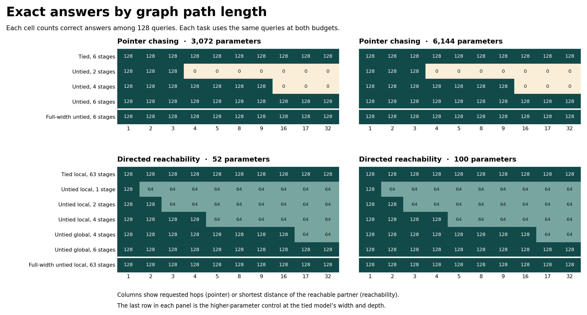

# Parameter sharing and graph reasoning depth

**Pointer chasing.** The six-stage tied and untied models each predicted all 1,280 endpoints correctly at both budgets (3,072 and 6,144 parameters).

**Directed reachability.** The 63-stage tied local and six-stage untied global models each predicted all 1,280 connectivity answers correctly at both budgets (52 and 100 parameters).

The held-out set contains 2,560 queries on 64-vertex graphs across both tasks. The same queries are reused across methods and budgets. The FLOAT32 run used a Tesla T4 with TF32 disabled. [Private Kaggle version 1, submitted 2026-11-24 UTC](https://www.kaggle.com/code/ajayasaithambi/loopedwsp-pointer-reachability/versions/1) · [Run receipt](<../../kaggle/runs/graph-depth/v1/submission.json>) · [Collected run verification](<../../kaggle/runs/graph-depth/v1/verification.json>)



## Exact answers by path length

Each cell is a count out of **128 queries**. Pointer chasing asks for the endpoint after exactly *k* steps. Reachability asks whether a path exists. The column for an unreachable graph gives its reachable partner’s shortest path length. The final row in each budget group repeats the tied model’s computation at full width using independently stored blocks. Its actual parameter count appears in the table. [All measurements and three timing repeats per cell](sizes.csv)

### Pointer chasing

| Budget | Model | Actual parameters | 1 | 2 | 3 | 4 | 5 | 8 | 9 | 16 | 17 | 32 |
| --- | --- | --- | --- | --- | --- | --- | --- | --- | --- | --- | --- | --- |
| 3,072 | Tied, 6 stages | 3,072 | 128 | 128 | 128 | 128 | 128 | 128 | 128 | 128 | 128 | 128 |
| 3,072 | Untied, 2 stages | 3,072 | 128 | 128 | 128 | 0 | 0 | 0 | 0 | 0 | 0 | 0 |
| 3,072 | Untied, 4 stages | 3,072 | 128 | 128 | 128 | 128 | 128 | 128 | 128 | 0 | 0 | 0 |
| 3,072 | Untied, 6 stages | 3,072 | 128 | 128 | 128 | 128 | 128 | 128 | 128 | 128 | 128 | 128 |
| 3,072 | Full-width untied, 6 stages | 18,432 | 128 | 128 | 128 | 128 | 128 | 128 | 128 | 128 | 128 | 128 |
| 6,144 | Tied, 6 stages | 6,144 | 128 | 128 | 128 | 128 | 128 | 128 | 128 | 128 | 128 | 128 |
| 6,144 | Untied, 2 stages | 6,144 | 128 | 128 | 128 | 0 | 0 | 0 | 0 | 0 | 0 | 0 |
| 6,144 | Untied, 4 stages | 6,144 | 128 | 128 | 128 | 128 | 128 | 128 | 128 | 0 | 0 | 0 |
| 6,144 | Untied, 6 stages | 6,144 | 128 | 128 | 128 | 128 | 128 | 128 | 128 | 128 | 128 | 128 |
| 6,144 | Full-width untied, 6 stages | 36,864 | 128 | 128 | 128 | 128 | 128 | 128 | 128 | 128 | 128 | 128 |

### Directed reachability

| Budget | Model | Actual parameters | 1 | 2 | 3 | 4 | 5 | 8 | 9 | 16 | 17 | 32 |
| --- | --- | --- | --- | --- | --- | --- | --- | --- | --- | --- | --- | --- |
| 52 | Tied local, 63 stages | 52 | 128 | 128 | 128 | 128 | 128 | 128 | 128 | 128 | 128 | 128 |
| 52 | Untied local, 1 stage | 52 | 128 | 64 | 64 | 64 | 64 | 64 | 64 | 64 | 64 | 64 |
| 52 | Untied local, 2 stages | 52 | 128 | 128 | 64 | 64 | 64 | 64 | 64 | 64 | 64 | 64 |
| 52 | Untied local, 4 stages | 52 | 128 | 128 | 128 | 128 | 64 | 64 | 64 | 64 | 64 | 64 |
| 52 | Untied global, 4 stages | 52 | 128 | 128 | 128 | 128 | 128 | 128 | 128 | 128 | 64 | 64 |
| 52 | Untied global, 6 stages | 52 | 128 | 128 | 128 | 128 | 128 | 128 | 128 | 128 | 128 | 128 |
| 52 | Full-width untied local, 63 stages | 3,028 | 128 | 128 | 128 | 128 | 128 | 128 | 128 | 128 | 128 | 128 |
| 100 | Tied local, 63 stages | 100 | 128 | 128 | 128 | 128 | 128 | 128 | 128 | 128 | 128 | 128 |
| 100 | Untied local, 1 stage | 100 | 128 | 64 | 64 | 64 | 64 | 64 | 64 | 64 | 64 | 64 |
| 100 | Untied local, 2 stages | 100 | 128 | 128 | 64 | 64 | 64 | 64 | 64 | 64 | 64 | 64 |
| 100 | Untied local, 4 stages | 100 | 128 | 128 | 128 | 128 | 64 | 64 | 64 | 64 | 64 | 64 |
| 100 | Untied global, 4 stages | 100 | 128 | 128 | 128 | 128 | 128 | 128 | 128 | 128 | 64 | 64 |
| 100 | Untied global, 6 stages | 100 | 128 | 128 | 128 | 128 | 128 | 128 | 128 | 128 | 128 | 128 |
| 100 | Full-width untied local, 63 stages | 6,052 | 128 | 128 | 128 | 128 | 128 | 128 | 128 | 128 | 128 | 128 |

## Counterfactual pairs and runtime

A pointer pair swaps two successors and changes the correct endpoint at the requested hop. A reachability pair swaps two edges, preserving every vertex’s in- and outdegree and flipping the connectivity answer. Both tasks keep the source fixed within a pair. Reachability also keeps the target fixed. A pair counts only when both predictions are correct.

Each model saw 640 pairs per task. **Tied only** counts individual queries that the tied reference answered correctly and the row model missed. **Row only** is the reverse. Timing is the median of the 10 per-length median wall times for 128 queries. Each length used 3 synchronized repeats in batches of 16, after warm-up. Graph tensors and endpoint IDs were already on the GPU, and the pointer table was in vertex-ID order. The timer included model input encoding, including conversion of the pointer hop count to a device tensor, and forward execution. Grading and disk I/O ran outside the timer. [Paired comparisons at every length](comparisons.csv)

### Pointer chasing

| Budget | Model | Both correct | Tied only | Row only | ms |
| --- | --- | --- | --- | --- | --- |
| 3,072 | Tied, 6 stages | 640/640 | 0 | 0 | 17.85 |
| 3,072 | Untied, 2 stages | 192/640 | 896 | 0 | 7.25 |
| 3,072 | Untied, 4 stages | 448/640 | 384 | 0 | 12.57 |
| 3,072 | Untied, 6 stages | 640/640 | 0 | 0 | 18.04 |
| 3,072 | Full-width untied, 6 stages | 640/640 | 0 | 0 | 18.17 |
| 6,144 | Tied, 6 stages | 640/640 | 0 | 0 | 18.19 |
| 6,144 | Untied, 2 stages | 192/640 | 896 | 0 | 7.25 |
| 6,144 | Untied, 4 stages | 448/640 | 384 | 0 | 12.64 |
| 6,144 | Untied, 6 stages | 640/640 | 0 | 0 | 18.30 |
| 6,144 | Full-width untied, 6 stages | 640/640 | 0 | 0 | 18.12 |

### Directed reachability

| Budget | Model | Both correct | Reachable correct | Unreachable correct | Tied only | Row only | ms |
| --- | --- | --- | --- | --- | --- | --- | --- |
| 52 | Tied local, 63 stages | 640/640 | 640/640 | 640/640 | 0 | 0 | 193.04 |
| 52 | Untied local, 1 stage | 64/640 | 64/640 | 640/640 | 576 | 0 | 5.58 |
| 52 | Untied local, 2 stages | 128/640 | 128/640 | 640/640 | 512 | 0 | 8.85 |
| 52 | Untied local, 4 stages | 256/640 | 256/640 | 640/640 | 384 | 0 | 15.21 |
| 52 | Untied global, 4 stages | 512/640 | 512/640 | 640/640 | 128 | 0 | 21.98 |
| 52 | Untied global, 6 stages | 640/640 | 640/640 | 640/640 | 0 | 0 | 29.90 |
| 52 | Full-width untied local, 63 stages | 640/640 | 640/640 | 640/640 | 0 | 0 | 202.09 |
| 100 | Tied local, 63 stages | 640/640 | 640/640 | 640/640 | 0 | 0 | 190.45 |
| 100 | Untied local, 1 stage | 64/640 | 64/640 | 640/640 | 576 | 0 | 5.57 |
| 100 | Untied local, 2 stages | 128/640 | 128/640 | 640/640 | 512 | 0 | 8.82 |
| 100 | Untied local, 4 stages | 256/640 | 256/640 | 640/640 | 384 | 0 | 15.26 |
| 100 | Untied global, 4 stages | 512/640 | 512/640 | 640/640 | 128 | 0 | 22.13 |
| 100 | Untied global, 6 stages | 640/640 | 640/640 | 640/640 | 0 | 0 | 31.49 |
| 100 | Full-width untied local, 63 stages | 640/640 | 640/640 | 640/640 | 0 | 0 | 199.80 |

## What accounts for the differences?

**Pointer chasing.** Every block composes the successor table with itself. Each stage selects whether to advance the source using one bit of the requested hop count. Two and four stages explicitly clip the request to 3 and 15 hops. Their out-of-range accuracy measures this design choice. At the same budget the six-stage untied model uses narrower address matrices than its tied counterpart. All variants keep a 64 × 64 successor table and a 64-component query state during inference.

**Depth with the same local weights.** One pass carries the source flag across one edge. Reusing that block for 63 passes lets the flag reach the end of any simple directed path on 64 vertices. The table counts changes on the same queries, across all ten lengths. Width, weights and input-edge mask are identical within each row.

| Parameters | Correct after 1 pass | Correct after 63 passes | Errors corrected | New errors |
| --- | --- | --- | --- | --- |
| 52 | 704/1,280 | 1,280/1,280 | 576 | 0 |
| 100 | 704/1,280 | 1,280/1,280 | 576 | 0 |

**Reachability at 32 hops.** Six global stages matched the 63-stage local model on both reachable and unreachable queries. Each global stage doubles the covered path length by composing the reachability relation with itself. Four global stages cover 16 edges and six cover all simple paths on 64 vertices. The table gives median inference time for the same 128 queries.

| Parameters | Model | Reachable correct | Unreachable correct | ms for 128 queries |
| --- | --- | --- | --- | --- |
| 52 | Untied local, 4 stages | 0/64 | 64/64 | 15.18 |
| 52 | Tied local, 63 stages | 64/64 | 64/64 | 197.47 |
| 52 | Untied global, 6 stages | 64/64 | 64/64 | 30.40 |
| 100 | Untied local, 4 stages | 0/64 | 64/64 | 15.15 |
| 100 | Tied local, 63 stages | 64/64 | 64/64 | 200.13 |
| 100 | Untied global, 6 stages | 64/64 | 64/64 | 31.61 |

The global model maintains 4,096 changing relation entries per graph. The local model maintains 64 source flags. Both also read the same 64 × 64 adjacency matrix and allocate attention intermediates. Matching parameter counts therefore leaves a substantial difference in working state and in the connections available to each stage.

**Storage at identical depth and width.** Giving every stage its own copy of the tied block repeats the same computation. The table counts changes in predicted labels when replacing shared tensors with independently stored copies.

| Task | Stages | Shared parameters | Independently stored parameters | Changed labels |
| --- | --- | --- | --- | --- |
| Pointer chasing | 6 | 3,072 | 18,432 | 0/1,280 |
| Pointer chasing | 6 | 6,144 | 36,864 | 0/1,280 |
| Directed reachability | 63 | 52 | 3,028 | 0/1,280 |
| Directed reachability | 63 | 100 | 6,052 | 0/1,280 |

These results cover analytically specified models and synthetic graphs of fixed size. The six-stage matched-budget alternatives show how width and the choice of operation can affect accuracy at a given depth. Finding the best construction at each depth and learning these algorithms from data are separate questions.

**Parameter counts and numerics.** Counts cover every stored `nn.Parameter` entry, including zeros, with reused weights counted once. Pointer projections use stored dense Fourier address matrices, with fixed one-hot IDs, identity value/output maps, hop-bit extraction and ReLU gating. Reachability heads partition vertex IDs and store scalar Q/K/V/O coefficients shared across vertices and relation coordinates. Masks, identity edges, fixed operations and working memory are excluded from the parameter budget. The scorer recorded 0 invalid outputs among 30,720 model predictions. Any nonfinite final logit invalidates that query. The raw results include every parameter and registered buffer in the tensor ledgers.

## Evidence and reproduction

[Frozen study protocol](<../../graph_depth/protocol.json>) · [Generator and label checks](<../../graph_depth/corpus.py>) · [Exact graphs and labels](<../../graph_depth/cases.npz>) · [Per-array hashes](<../../graph_depth/cases-manifest.json>)

[Model details and run instructions](<../../graph_depth/README.md>) · [Pointer model](<../../graph_depth/pointer.py>) · [Reachability models](<../../graph_depth/reachability.py>) · [GPU evaluation](<../../graph_depth/experiment.py>) · [Report generator](<../../graph_depth/report.py>)

[Raw conditions, repeat timings and tensor ledgers](<../../kaggle/runs/graph-depth/v1/output/graph-depth-results.json>) · [Per-query predictions](<../../kaggle/runs/graph-depth/v1/output/graph-depth-predictions.npz>) · [GPU runtime and output hashes](<../../kaggle/runs/graph-depth/v1/output/graph-depth-runtime.json>)

[Independent audit](audit.json) · [Paired comparison counts](comparisons.csv) · [All accuracy and timing measurements](sizes.csv) · [Audit code](<../../graph_depth/audit.py>)

With NumPy, PyTorch and Matplotlib installed, run from the repository root. The first command evaluates the development split on CPU. The second reruns the frozen test on CUDA. The last two independently audit the collected run and regenerate the report, CSV and figure.

```sh
python graph_depth/experiment.py dev
python graph_depth/experiment.py gpu --output audit-output/graph-depth-gpu
python graph_depth/audit.py kaggle/runs/graph-depth/v1 results/graph-depth/audit.json results/graph-depth/comparisons.csv
python graph_depth/report.py kaggle/runs/graph-depth/v1 results/graph-depth
```
