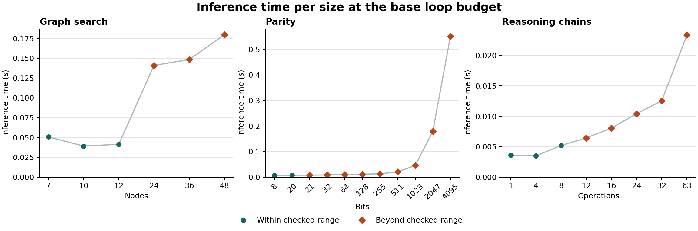

# Length generalization on Kaggle

The three frozen transformers answered **1,792 of 1,792 held-out cases** correctly (100.00%). Their synchronized inference time at the base loop budget R totaled **1.5350 seconds** on Tesla T4.

## Performance inside and beyond the checked range

| Group | Correct / cases | Accuracy | R time (s) |
|---|---:|---:|---:|
| Graph search, within | 288/288 | 100.00% | 0.1313 |
| Graph search, beyond | 288/288 | 100.00% | 0.4688 |
| Parity, within | 128/128 | 100.00% | 0.0142 |
| Parity, beyond | 576/576 | 100.00% | 0.8476 |
| Reasoning chains, within | 192/192 | 100.00% | 0.0123 |
| Reasoning chains, beyond | 320/320 | 100.00% | 0.0608 |
| All tasks, within | 608/608 | 100.00% | 0.1578 |
| All tasks, beyond | 1,184/1,184 | 100.00% | 1.3772 |

At 2R and 4R the models answered 1,792/1,792 and 1,792/1,792 correctly. Predictions agreed across all three checkpoints on 1,792/1,792 cases.

## Runtime by size

Each size contains 96 for graph search, 64 for parity, 64 for reasoning chains. Each dot represents one timed pass over that size’s held-out cases. Sizes are spaced evenly as categories. Each panel has its own time axis.

| Task | Size | Range | Correct / cases | Accuracy | R time (s) |
|---|---:|---|---:|---:|---:|
| Graph search | 7 nodes | within | 96/96 | 100.00% | 0.0507 |
| Graph search | 10 nodes | within | 96/96 | 100.00% | 0.0392 |
| Graph search | 12 nodes | within | 96/96 | 100.00% | 0.0413 |
| Graph search | 24 nodes | beyond | 96/96 | 100.00% | 0.1409 |
| Graph search | 36 nodes | beyond | 96/96 | 100.00% | 0.1483 |
| Graph search | 48 nodes | beyond | 96/96 | 100.00% | 0.1796 |
| Parity | 8 bits | within | 64/64 | 100.00% | 0.0065 |
| Parity | 20 bits | within | 64/64 | 100.00% | 0.0077 |
| Parity | 21 bits | beyond | 64/64 | 100.00% | 0.0078 |
| Parity | 32 bits | beyond | 64/64 | 100.00% | 0.0086 |
| Parity | 64 bits | beyond | 64/64 | 100.00% | 0.0098 |
| Parity | 128 bits | beyond | 64/64 | 100.00% | 0.0116 |
| Parity | 255 bits | beyond | 64/64 | 100.00% | 0.0129 |
| Parity | 511 bits | beyond | 64/64 | 100.00% | 0.0208 |
| Parity | 1023 bits | beyond | 64/64 | 100.00% | 0.0453 |
| Parity | 2047 bits | beyond | 64/64 | 100.00% | 0.1791 |
| Parity | 4095 bits | beyond | 64/64 | 100.00% | 0.5516 |
| Reasoning chains | 1 operations | within | 64/64 | 100.00% | 0.0036 |
| Reasoning chains | 4 operations | within | 64/64 | 100.00% | 0.0035 |
| Reasoning chains | 8 operations | within | 64/64 | 100.00% | 0.0052 |
| Reasoning chains | 12 operations | beyond | 64/64 | 100.00% | 0.0064 |
| Reasoning chains | 16 operations | beyond | 64/64 | 100.00% | 0.0081 |
| Reasoning chains | 24 operations | beyond | 64/64 | 100.00% | 0.0104 |
| Reasoning chains | 32 operations | beyond | 64/64 | 100.00% | 0.0125 |
| Reasoning chains | 63 operations | beyond | 64/64 | 100.00% | 0.0233 |

## Graph reachability and shortest-path length

| Group | Correct / cases | Accuracy | R time (s) |
|---|---:|---:|---:|
| Within, reachable | 216/216 | 100.00% | 0.1092 |
| Within, unreachable | 72/72 | 100.00% | 0.0221 |
| Beyond, reachable | 216/216 | 100.00% | 0.3869 |
| Beyond, unreachable | 72/72 | 100.00% | 0.0819 |

Hop counts refer to the shortest directed path from the source to the target.

| Shortest path | Correct / cases | Accuracy | R time (s) |
|---|---:|---:|---:|
| 1 hop | 54/54 | 100.00% | 0.0253 |
| 2 hops | 54/54 | 100.00% | 0.0272 |
| 3 hops | 54/54 | 100.00% | 0.0241 |
| 4 hops | 54/54 | 100.00% | 0.0325 |
| 8 hops | 24/24 | 100.00% | 0.0366 |
| 9 hops | 24/24 | 100.00% | 0.0407 |
| 10 hops | 24/24 | 100.00% | 0.0408 |
| 11 hops | 24/24 | 100.00% | 0.0407 |
| 12 hops | 24/24 | 100.00% | 0.0420 |
| 13 hops | 24/24 | 100.00% | 0.0463 |
| 14 hops | 24/24 | 100.00% | 0.0428 |
| 15 hops | 24/24 | 100.00% | 0.0484 |
| 16 hops | 24/24 | 100.00% | 0.0485 |
| Unreachable | 144/144 | 100.00% | 0.1040 |

## Models

| Task | Dense parameters | What the tied block computes |
|---|---:|---|
| Graph search | 46,624 | Passes a decreasing value along each directed edge. The largest value at a node represents its shortest distance from the source. Zero represents unreachable. |
| Parity | 20,575 | Combines pairs of partial parities by XOR and doubles the reach of the next pass. The fixed positional table supports up to 4,095 input bits. |
| Reasoning chains | 3,321 | Looks up the variable on the right of each shuffled assignment and applies the signed integer update. One more dependency resolves on each pass. |

The report counts all embedding, attention, MLP and readout entries. The pointer-doubling parity design has 68 entries in its recurrent block. These analytic builds ran in FP64.

## Inputs and timing

This sweep uses newly generated inputs. The checked and extended length ranges follow the authors’ graph-search, parity and reasoning-chain experiments. [LoopedWSP study](https://mbzuai-oryx.github.io/LoopedWSP/) · [Released task interfaces](https://github.com/mbzuai-oryx/LoopedWSP/tree/main/weights)

The graph generator shuffles relabeled directed graphs and grades the query with breadth-first search. Parity cases balance even and odd bit counts. Reasoning chains shuffle one base assignment and signed integer updates, then query the terminal variable. The evaluator uses distinct PCG64 streams for development and evaluation, with root seeds 41 and 42, and excludes exact development duplicates. The accompanying CSV records the model and corpus hashes for each size. [Per-size measurements](results.csv)

R denotes each model’s prescribed loop budget. The timer synchronizes CUDA and includes batch stacking, device transfers, attention preparation, transformer steps and readout. Each size’s time sums its batch measurements. Graph batches group by shortest-path category and token count. The evaluator skips repeated iterations after observing an exact full-state fixed point. Corpus generation, model loading and the extra 2R and 4R checks fall outside the reported R time.
