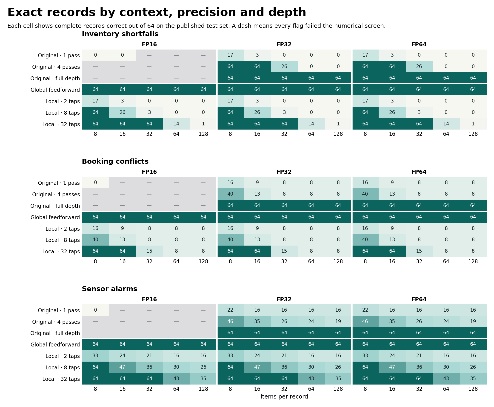

# When does looping help?

In FP64, changing only the depth of the frozen transformer corrected **1,121** whole records that one pass missed and lost **0** that one pass got right. The full-depth model matched **960/960** released records and **480/480** challenge records. The task-specific global feedforward models matched **960/960** and **480/480**, respectively.

Each task contributes 64 released records and 16 new pairs at each of five lengths. Pairs share every input after the first and have opposite final labels. Whole-record accuracy requires every event, booking, or reading to be correct. A pair passes the final-label check only when both members have the correct final decision.

Execution used Tesla T4. [Private Kaggle run, version 1, 2026-11-24 UTC](https://www.kaggle.com/code/ajayasaithambi/loopedwsp-loop-comparisons/versions/1) · [Run receipt](<../../kaggle/runs/loop-comparisons/v1/submission.json>) · [Frozen experimental protocol](<../../comparisons/protocol.json>)

## Depth and the final decision

Counts below pool the five lengths. In the paired depth comparison, a full-only match means the entire record became correct at full depth. A one-only match means it became incorrect. Both runs used exactly the same stored coefficients. The inventory block doubles its coverage per pass. The booking and alarm blocks pass information between adjacent input positions.

| Task | Precision | Released full-only / one-only | Challenge full-only / one-only | Both final labels correct in 80 pairs, one / full / global |
|---|---|---|---|---|
| Inventory | float64 | 300 / 0 | 156 / 0 | 0 / 80 / 80 |
| Inventory | float32 | 300 / 0 | 156 / 0 | 0 / 80 / 80 |
| Inventory | float16 | 0 / 0 | 0 / 0 | 0 / 0 / 80 |
| Booking conflicts | float64 | 271 / 0 | 80 / 0 | 0 / 80 / 80 |
| Booking conflicts | float32 | 271 / 0 | 80 / 0 | 0 / 80 / 80 |
| Booking conflicts | float16 | 0 / 0 | 0 / 0 | 0 / 0 / 80 |
| Alarm state | float64 | 234 / 0 | 80 / 0 | 0 / 80 / 80 |
| Alarm state | float32 | 234 / 0 | 80 / 0 | 0 / 80 / 80 |
| Alarm state | float16 | 0 / 0 | 0 / 0 | 0 / 0 / 80 |

For these constructed pairs, a deterministic final decision that cannot see the first row receives identical inputs for both members. Their opposite labels limit it to one correct final decision per pair. Inventory and alarm windows reach the first row when the length is at most the window width W. The symmetric booking window reaches it when the index distance from the first to last row, length − 1, is at most W/2. A global feedforward computation also has access to the first row.

## Results by sequence length

Each FP64 cell gives two whole-record counts, **released out of 64 · challenge out of 32**. Windows use the indicated number of taps. The CSV includes all three precisions, final-label scores, invalid decisions, and paired depth outcomes for each length. [All 315 measurements](<sizes.csv>)

| Task | Length | 1 pass | 4 passes | Full depth | Global feedforward | Window 2 | Window 8 | Window 32 |
|---|---|---|---|---|---|---|---|---|
| Inventory | 8 | 17 · 3 | 64 · 32 | 64 · 32 | 64 · 32 | 17 · 3 | 64 · 32 | 64 · 32 |
| Inventory | 16 | 3 · 1 | 64 · 32 | 64 · 32 | 64 · 32 | 3 · 1 | 26 · 5 | 64 · 32 |
| Inventory | 32 | 0 · 0 | 26 · 1 | 64 · 32 | 64 · 32 | 0 · 0 | 3 · 0 | 64 · 32 |
| Inventory | 64 | 0 · 0 | 0 · 0 | 64 · 32 | 64 · 32 | 0 · 0 | 0 · 0 | 14 · 0 |
| Inventory | 128 | 0 · 0 | 0 · 0 | 64 · 32 | 64 · 32 | 0 · 0 | 0 · 0 | 1 · 0 |
| Booking conflicts | 8 | 16 · 16 | 40 · 16 | 64 · 32 | 64 · 32 | 16 · 16 | 40 · 16 | 64 · 32 |
| Booking conflicts | 16 | 9 · 16 | 13 · 16 | 64 · 32 | 64 · 32 | 9 · 16 | 13 · 16 | 64 · 32 |
| Booking conflicts | 32 | 8 · 16 | 8 · 16 | 64 · 32 | 64 · 32 | 8 · 16 | 8 · 16 | 15 · 16 |
| Booking conflicts | 64 | 8 · 16 | 8 · 16 | 64 · 32 | 64 · 32 | 8 · 16 | 8 · 16 | 8 · 16 |
| Booking conflicts | 128 | 8 · 16 | 8 · 16 | 64 · 32 | 64 · 32 | 8 · 16 | 8 · 16 | 8 · 16 |
| Alarm state | 8 | 22 · 16 | 46 · 16 | 64 · 32 | 64 · 32 | 33 · 16 | 64 · 32 | 64 · 32 |
| Alarm state | 16 | 16 · 16 | 35 · 16 | 64 · 32 | 64 · 32 | 24 · 16 | 47 · 16 | 64 · 32 |
| Alarm state | 32 | 16 · 16 | 26 · 16 | 64 · 32 | 64 · 32 | 21 · 16 | 36 · 16 | 64 · 32 |
| Alarm state | 64 | 16 · 16 | 24 · 16 | 64 · 32 | 64 · 32 | 16 · 16 | 30 · 16 | 43 · 16 |
| Alarm state | 128 | 16 · 16 | 19 · 16 | 64 · 32 | 64 · 32 | 16 · 16 | 26 · 16 | 35 · 16 |

## Precision and invalid outputs

Each cell gives released exact records out of 320 and challenge exact records out of 160. The same 480 records per task were evaluated at every precision.

| Task | Precision | One pass | Full depth | Global feedforward |
|---|---|---|---|---|
| Inventory | float64 | 20 · 4 | 320 · 160 | 320 · 160 |
| Inventory | float32 | 20 · 4 | 320 · 160 | 320 · 160 |
| Inventory | float16 | 0 · 0 | 0 · 0 | 320 · 160 |
| Booking conflicts | float64 | 49 · 80 | 320 · 160 | 320 · 160 |
| Booking conflicts | float32 | 49 · 80 | 320 · 160 | 320 · 160 |
| Booking conflicts | float16 | 0 · 0 | 0 · 0 | 320 · 160 |
| Alarm state | float64 | 86 · 80 | 320 · 160 | 320 · 160 |
| Alarm state | float32 | 86 · 80 | 320 · 160 | 320 · 160 |
| Alarm state | float16 | 0 · 0 | 0 · 0 | 320 · 160 |

The frozen transformer tracks nonfinite attention scores, updates, hidden computations, and logits. A flagged token is incorrect in the strict score. The raw score uses the final logits alone and counts nonfinite output scores as incorrect. An intermediate overflow can disappear inside softmax or ReLU, so a finite final value can still follow a numerical failure. The table pools 480 records and 23,808 token decisions per task at FP16.

| Task | Depth | Strict exact / 480 | Raw exact / 480 | Strict invalid decisions | Raw invalid decisions |
|---|---|---|---|---|---|
| Inventory | 1 pass | 0 | 5 | 23,136 | 19,968 |
| Inventory | 4 passes | 0 | 45 | 23,808 | 23,040 |
| Inventory | Full depth | 0 | 45 | 23,808 | 23,040 |
| Booking conflicts | 1 pass | 0 | 0 | 23,424 | 20,928 |
| Booking conflicts | 4 passes | 0 | 0 | 23,808 | 23,808 |
| Booking conflicts | Full depth | 0 | 0 | 23,808 | 23,808 |
| Alarm state | 1 pass | 0 | 0 | 23,424 | 20,448 |
| Alarm state | 4 passes | 0 | 0 | 23,808 | 23,808 |
| Alarm state | Full depth | 0 | 0 | 23,808 | 23,808 |

At full depth the FP16 numerical screen flagged **71,424** token decisions. Using the final logits alone, **45/1,440** records were exact.

## Parameter budgets

The three depth variants share tensors. The feedforward designs encode task knowledge in their operators, including a causal prefix aggregation, interval-pair comparisons, and selection of the most recent threshold event. Counts cover stored coefficients, including zeros. Masks, indices, and fixed operations have no stored scalar cost in this accounting. The counts therefore cannot establish a universal minimum or account for all implementation complexity.

| Task | Original at all depths | Global feedforward | Window 2 | Window 8 | Window 32 |
|---|---|---|---|---|---|
| Inventory | 1400 | 3 | 5 | 11 | 35 |
| Booking conflicts | 61830 | 16 | 18 | 24 | 48 |
| Alarm state | 1508 | 4 | 5 | 11 | 35 |

Each budget cell gives the highest FP64 **released / 320 · challenge / 160** whole-record counts among eligible methods, pooled across lengths. Each cohort selects its own best method. A dash means no measured method fit. The CSV identifies every tied method and its actual parameter count at each precision and length. [Parameter-budget results](<parameter-budgets.csv>)

| Task | ≤ 16 | ≤ 64 | ≤ 256 | ≤ 2,048 | ≤ 65,536 |
|---|---|---|---|---|---|
| Inventory | 320 · 160 | 320 · 160 | 320 · 160 | 320 · 160 | 320 · 160 |
| Booking conflicts | 320 · 160 | 320 · 160 | 320 · 160 | 320 · 160 | 320 · 160 |
| Alarm state | 320 · 160 | 320 · 160 | 320 · 160 | 320 · 160 | 320 · 160 |

### Window width at 128 items

Each FP32 cell gives **parameter count (released exact out of 64 · challenge exact out of 32)**. A wider local window adds tap coefficients and exposes more input rows, so both factors change together. The paired challenge changes row 1 and checks the final decision at row 128, 127 positions away. The widest local inventory and alarm models can look back 31 positions. The widest local booking model can inspect 16 neighbors on each side.

| Task | Window 2 | Window 8 | Window 32 | Global feedforward | Full depth |
|---|---|---|---|---|---|
| Inventory | 5 (0 · 0) | 11 (0 · 0) | 35 (1 · 0) | 3 (64 · 32) | 1,400 (64 · 32) |
| Booking conflicts | 18 (8 · 16) | 24 (8 · 16) | 48 (8 · 16) | 16 (64 · 32) | 61,830 (64 · 32) |
| Alarm state | 5 (16 · 16) | 11 (26 · 16) | 35 (35 · 16) | 4 (64 · 32) | 1,508 (64 · 32) |

## Runtime and evidence

Times are synchronized GPU wall times for 96 preloaded records in batches of 16. Each cell below is the median of three runs in milliseconds at length 128 and FP32. The transformer recomputes dense attention at every requested step, including intermediate finite-value checks. The operators and checks differ for the task-specific baselines. Data transfer, grading, model setup, and the Kaggle queue fall outside the timer.

| Task | 1 pass | 4 passes | Full depth | Global feedforward | Window 2 | Window 8 | Window 32 |
|---|---|---|---|---|---|---|---|
| Inventory | 6.039 | 15.822 | 27.604 | 2.162 | 1.563 | 1.661 | 1.613 |
| Booking conflicts | 11.110 | 29.482 | 832.620 | 1.917 | 1.925 | 1.724 | 1.661 |
| Alarm state | 5.931 | 17.058 | 430.601 | 2.067 | 1.575 | 1.478 | 1.510 |

The comparison covers the three synthetic generators and the measured lengths of 8 through 128 items. All models were written analytically. The study supplies no measurements on customer records, learned deep models, or inputs beyond the frozen positional tables.

[Measured result JSON](<../../kaggle/runs/loop-comparisons/v1/output/comparison-results.json>) · [Archived predictions](<../../kaggle/runs/loop-comparisons/v1/output/comparison-predictions.npz>) · [Released cases](<../../applications/cases.npz>) · [Paired challenges](<../../comparisons/challenge.npz>) · [Frozen transformer forward](<../../comparisons/recurrent.py>) · [Feedforward operators](<../../comparisons/baselines.py>) · [Study design and reproduction](<../../comparisons/README.md>) · [GPU evaluator](<../../comparisons/experiment.py>) · [Independent audit](<audit.json>) · [Challenge generator](<../../comparisons/make_challenges.py>)
