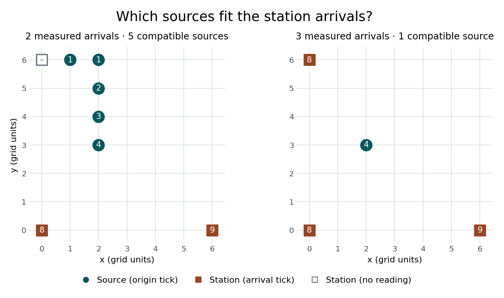

# Seismic source location, Braille reading and bridge endgames

The three hand-programmed transformers matched independent references on **768/768 complete held-out records** and 22,144/22,144 individual outputs on a Kaggle Tesla T4. At sizes above the development range, 384/384 records were exact. The separate worked examples matched on 11/11 inputs.

## Accuracy and runtime

| Application | Size | FP32 parameters | Exact records | Correct labels | Median GPU time (ms) |
| --- | --- | --- | --- | --- | --- |
| Seismic source | 2 | 74 | 64/64 | 3,136/3,136 | 6.074 |
| Seismic source | 4 | 74 | 64/64 | 3,136/3,136 | 6.401 |
| Seismic source | 8 | 74 | 64/64 | 3,136/3,136 | 6.157 |
| Seismic source | 16 | 74 | 64/64 | 3,136/3,136 | 6.269 |
| Braille line | 8 | 127 | 64/64 | 512/512 | 6.018 |
| Braille line | 16 | 127 | 64/64 | 1,024/1,024 | 5.478 |
| Braille line | 32 | 127 | 64/64 | 2,048/2,048 | 5.532 |
| Braille line | 64 | 127 | 64/64 | 4,096/4,096 | 5.487 |
| Bridge endgame | 2 | 3 | 64/64 | 128/128 | 10.120 |
| Bridge endgame | 4 | 3 | 64/64 | 256/256 | 11.043 |
| Bridge endgame | 8 | 3 | 64/64 | 512/512 | 11.168 |
| Bridge endgame | 16 | 3 | 64/64 | 1,024/1,024 | 11.601 |

Size counts station rows per event, cells per Braille line or independent bridge deals per record. A seismic record requires the entire location and origin-time map. A Braille line requires every aligned reading, including silent indicators. A bridge record requires the trick count and all optimal leads on every deal. Development used 8 records per size at 2 and 4 stations, 8 and 16 Braille cells, and 2 and 4 bridge deals.

Each time is the median of 3 synchronized FP32 forward sweeps over 64 GPU-resident records in batches of 8, after warm-up, with TF32 disabled. Encoding, data transfers, decoding and scoring fall outside the timed interval. Parameter counts include stored FP32 coefficients, including zeros. Fixed program logic also supplies the encodings, masks, arithmetic and output interpretation. [All timing repeats in seconds](sizes.csv)

## Seismology · locating a source from first arrivals



The synthetic event starts at an integer tick from 0 to 15 on a 7 × 7 horizontal grid. A circular wave travels one grid unit per tick in a homogeneous medium. Each measured station reports the first integer tick at or after arrival. For example, from (2, 3) the wave reaches (0, 0) in √13 ticks, so the recorded delay is 4. An attention lookup reads the travel delay for each station-to-source squared distance. Two more attention reads find the earliest and latest origin ticks implied at each location. A location qualifies when these agree and the tick falls in range. The figure uses the two saved GPU maps. A square with a dash marks the third station while its reading is missing.

| Worked event | Stations (x, y) and arrival tick | GPU sources (x, y) and origin tick |
| --- | --- | --- |
| Two recorded arrivals | (0, 0) 8, (6, 0) 9, (0, 6) missing | (2, 3) 4, (2, 4) 3, (2, 5) 2, (1, 6) 1, (2, 6) 1 |
| Third arrival added | (0, 0) 8, (6, 0) 9, (0, 6) 8 | (2, 3) 4 |
| Conflicting adjacent stations | (0, 0) 8, (1, 0) 10 | No compatible source |
| Source at a station | (0, 0) 0, (3, 4) 5, (6, 6) 9 | (0, 0) 0 |

| Compatible locations in event | Exact maps / tested events |
| --- | --- |
| None | 84/84 |
| Exactly one | 65/65 |
| More than one | 107/107 |

At individual compatible locations, 1,102/1,102 predicted origin ticks were correct. The complete-map scores above also check every location that should be excluded. The generator mixes consistent arrivals, missing measurements, layouts admitting multiple sources, one-tick perturbations and contradictory readings. More stations constrain the same 49 possible source locations. This toy inversion omits depth, variable wave speed and measurement uncertainty. [Runnable seismic example](../../mosaic/quake_notes.md)

## Accessibility · reading a bounded uncontracted English Braille label

The reader receives ordered six-dot cells and emits a print character or a silent indicator at each position. Dots 12 can print as b, B or 2 depending on earlier indicators. One attention head matches the raised dots to a glyph and another reads the most recent earlier cell that starts or ends numeric mode. The sampled lines exercise long integers, grade-1 and letter transitions out of number mode, capitals and spaces. The inputs use transcribed dot patterns. The supported repertoire covers the English alphabet, single capitals, integers, grade-1 symbol indicators and blanks. Contractions, punctuation and physical dot recognition fall outside it. [Runnable Braille example](../../mosaic/braille_notes.md)

| Worked line | Raised dot numbers in cell order | GPU text |
| --- | --- | --- |
| Room number with a letter suffix | 6 1235 135 135 134 blank 3456 12 245 145 56 12 | `Room 204b` |
| Dots 12 in lowercase, numeric and capital contexts | 12 1 145 blank 3456 12 1 145 blank 6 12 1 145 | `bad 214 Bad` |
| A k–z cell or a capital sign ends a number | 3456 14 145 13 1 blank 3456 14 6 12 | `34ka 3B` |
| Twelve digits followed by a grade-1 letter | 3456 1 12 14 145 15 124 1245 125 24 245 1 245 56 245 | `123456789010j` |

| Reference cell reading | Correct / tested |
| --- | --- |
| Digit | 4,204/4,204 |
| Uppercase | 100/100 |
| Lowercase | 2,868/2,868 |
| Space | 100/100 |
| Indicator | 408/408 |

### Can the first indicator change the final character?

Within each additional pair, the first line starts with a number indicator and the second with a single-capital indicator. Every cell after that is identical in both lines and uses an a–j pattern. The last cell must read as a digit in one line and a lowercase letter in the other. A deterministic reader that sees only the shared suffix must give the same final character twice, so it can get at most one of the two right. Eight pairs end with each of the ten patterns at each size. The paired lines are distinct from the sampled benchmark and are scored separately.

| Cells per line | Both final characters correct / pairs | Both complete lines exact / pairs |
| --- | --- | --- |
| 8 | 80/80 | 80/80 |
| 16 | 80/80 | 80/80 |
| 32 | 80/80 | 80/80 |
| 64 | 80/80 | 80/80 |

The GPU recovered both complete lines in 320/320 pairs and both final characters in 320/320 pairs.

## Contract bridge · choosing an opening lead with two tricks left

Each player holds two cards and all four hands are visible. In this double-dummy ending North and South maximize their remaining tricks, while East and West minimize them. Each deal requires the North–South total and every optimal opening card. The model scores possible first-trick plays in parallel. Attention selects each trick winner and backs up the best legal replies for the partnership on turn. In the worked king-of-clubs hand, changing the trump suit changes the value of leading the six of spades. NT means no-trump. Card names put suit before rank. [Runnable bridge example and full hands](../../mosaic/bridge_notes.md)

| Worked ending | Leader | Trump | Opening hand | Forced NS tricks | Optimal leads |
| --- | --- | --- | --- | --- | --- |
| King of clubs or six of spades | N | NT | CK / S6 | 1 | S6 |
| King of clubs or six of spades | N | H | CK / S6 | 0 | CK / S6 |
| Same position rotated to East | E | NT | CK / S6 | 1 | S6 |
| Every hand contains a spade | N | NT | SA / SK | 2 | SA / SK |
| Every hand contains a spade | N | D | SA / SK | 1 | SA / SK |

| Reference deal category | Correct / tested |
| --- | --- |
| One optimal lead | 329/329 |
| Both leads optimal | 1,591/1,591 |
| No-trump contract | 642/642 |
| Suit contract | 1,278/1,278 |
| Higher-ranked card strictly worse | 95/95 |

The deal categories overlap across rows. The generator samples eight distinct cards from decks restricted to one, two or four suits and mixes suit and no-trump contracts. Increasing the size adds independent deals to one record. Search depth stays at two tricks. Hidden hands, bidding and full 13-trick play are outside this experiment.

## Reproduce the run

[Worked inputs and labels](../../mosaic/checks.json) · [Frozen protocol](../../mosaic/protocol.json) · [Independent audit](audit.json) · [Saved predictions](../../kaggle/runs/mosaic/v1/output/mosaic-predictions.npz) · [GPU verification](../../kaggle/runs/mosaic/v1/verification.json) · [Submission receipt](../../kaggle/runs/mosaic/v1/submission.json) · [Private Kaggle run](https://www.kaggle.com/code/ajayasaithambi/loopedwsp-quakes-braille-and-bridge/versions/1)

```sh
python mosaic/experiment.py predict quake --example
python mosaic/experiment.py predict braille --example
python mosaic/experiment.py predict bridge --example
python mosaic/audit.py kaggle/runs/mosaic/v1 audit-output/mosaic-audit.json
python mosaic/report.py kaggle/runs/mosaic/v1 results/mosaic
```
