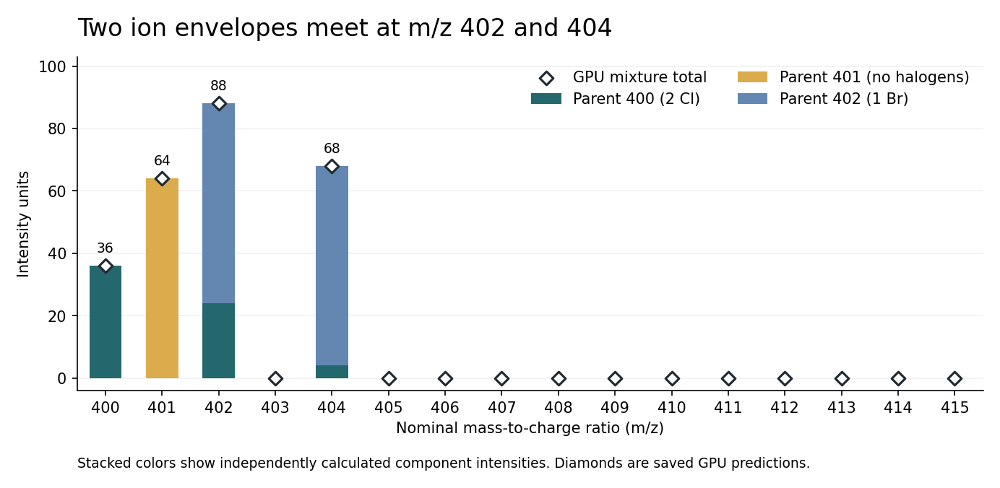

# Isotope envelopes, the Maya Calendar Round and tabletop robotics

On a Kaggle Tesla T4, the three hand-programmed models matched **768/768 held-out records** and **7,936/7,936 complete answers**. The two sizes beyond development accounted for 384/384 exact records. The separate worked checks passed on 11/11 inputs.

## Accuracy and runtime by input size

| Application | Size | Stored FP32 weights | Exact records | Complete answers | Correct integer labels | Median GPU ms |
| --- | --- | --- | --- | --- | --- | --- |
| Isotope envelopes | 2 | 3 | 64/64 | 1,024/1,024 | 1,024/1,024 | 9.28 |
| Isotope envelopes | 4 | 3 | 64/64 | 1,024/1,024 | 1,024/1,024 | 9.45 |
| Isotope envelopes | 8 | 3 | 64/64 | 1,024/1,024 | 1,024/1,024 | 9.21 |
| Isotope envelopes | 16 | 3 | 64/64 | 1,024/1,024 | 1,024/1,024 | 8.77 |
| Maya Calendar Round | 2 | 1,292 | 64/64 | 128/128 | 256/256 | 5.89 |
| Maya Calendar Round | 4 | 1,292 | 64/64 | 256/256 | 512/512 | 7.29 |
| Maya Calendar Round | 8 | 1,292 | 64/64 | 512/512 | 1,024/1,024 | 6.23 |
| Maya Calendar Round | 16 | 1,292 | 64/64 | 1,024/1,024 | 2,048/2,048 | 6.28 |
| Lattice arm | 2 | 9 | 64/64 | 128/128 | 256/256 | 9.98 |
| Lattice arm | 4 | 9 | 64/64 | 256/256 | 512/512 | 10.34 |
| Lattice arm | 8 | 9 | 64/64 | 512/512 | 1,024/1,024 | 10.44 |
| Lattice arm | 16 | 9 | 64/64 | 1,024/1,024 | 2,048/2,048 | 10.43 |

Size counts ion components in one mixture, date pairs in one list, or target positions in one arm scene. Each intensity bin contributes one integer label. One calendar answer requires both parts of its offset or the incompatible pair. One arm answer requires the exact count and first witness, including the sentinel for an unreachable target. Exact record accuracy requires every answer in that record. Longer date lists and arm target lists increase the number of queries. The Calendar Round length and the arm’s four links stay fixed.

Each time is the median of 3 synchronized forward sweeps over 64 GPU-resident records after warm-up, in batches of 8. Timing excludes encoding, transfers, decoding and verification. Weight counts include stored FP32 coefficients, including zeros, and count shared weights once. Each model also uses fixed operations and working memory. [All timing repeats](sizes.csv)

## Analytical chemistry · overlapping isotope envelopes



Each abundance unit supplies 64 intensity units. Only chlorine and bromine contribute isotope shifts, with idealized heavy fractions of 1/4 and 1/2. The example's bin at m/z 402 receives 24 units from the two-chlorine component and 64 from the bromine component. The GPU predicted 88. The table lists only occupied peaks. All 16 nominal bins contribute to each test score.

| Parent masses and component inputs | Nonzero GPU bins (intensity) |
| --- | --- |
| 400 (1 Cl, 0 Br, amount 1) | 400 (48), 402 (16) |
| 401 (0 Cl, 1 Br, amount 1) | 401 (32), 403 (32) |
| 400 (2 Cl, 0 Br, amount 1), 401 (0 Cl, 0 Br, amount 1), 402 (0 Cl, 1 Br, amount 2) | 400 (36), 401 (64), 402 (88), 404 (68) |
| 409 (2 Cl, 1 Br, amount 1) | 409 (18), 411 (30), 413 (14), 415 (2) |

The model matched 2,006/2,006 occupied bins and 2,090/2,090 empty bins. Among the occupied bins, it matched 771/771 that received intensity from distinct light-isotope parent masses. The generator samples broad mass ranges, same-parity masses and narrow clusters to exercise overlaps. Real spectra can contain isotope satellites from other elements, instrumental broadening and noise. [Runnable mixture](../../prism/isotopes_notes.md)

## Mesoamerican calendrics · reconciling two date cycles

The 260-day Tzolk'in and 365-day Haab' repeat together after 18,980 days. A compatible pair identifies one offset in that round, counted from 4 Ajaw 8 Kumk'u. A pair incompatible with this alignment has no offset. These are relative cycle positions. The same designation recurs in subsequent rounds.

| Paired Tzolk'in and Haab' designation | GPU day offset or incompatibility |
| --- | --- |
| 4 Ajaw · 8 Kumk'u | 0 |
| 4 Ajaw · 9 Kumk'u | incompatible |
| 3 Kawak · 7 Kumk'u | 18979 |
| 2 Chuwen · 19 Kumk'u | 11 |
| 3 Eb' · 0 Wayeb' | 12 |
| 7 Kib' · 4 Wayeb' | 16 |
| 8 Kab'an · 0 Pop | 17 |
| 4 Ajaw · 3 Mak | 260 |
| 5 Chicchan · 8 Kumk'u | 365 |

The model matched 960/960 compatible offsets and 960/960 incompatible pairs. It matched 504/504 requests in the five-day final month, Wayeb'. The generator pairs valid dates with altered day names and deliberately samples Wayeb' dates. Those proportions describe the test design. [Runnable calendar example](../../prism/calendar_round_notes.md)

In a separate prespecified GPU sweep, the model answered 94,900/94,900 well-formed pairs exactly. It produced the right offset for 18,980/18,980 compatible pairs and recognized 75,920/75,920 incompatible pairs. This covers the Cartesian product of the 260 Tzolk'in positions and 365 Haab' positions. The headline record counts and timing table cover the sampled benchmark separately.

## Robotics · count collision-free lattice-arm poses

The arm has four links and three choices per joint, yielding 81 candidate words. For each target the GPU returns the number of feasible words and the first in left, straight, right order. Each candidate must avoid the obstacle points and self-intersection, including along the interior of a link. On the unit-link board, blocking [1,0] cuts the possible poses at [2,2] from six to three.

| Link lengths | Obstacles | Targets in input order | GPU count (first pose) |
| --- | --- | --- | --- |
| [1, 1, 1, 1] | [] | [[2, 2], [4, 0], [0, 0]] | 6 (LSRS), 1 (SSSS), 0 (none) |
| [1, 1, 1, 1] | [[1, 0]] | [[2, 2], [4, 0], [0, 0]] | 3 (LSRS), 0 (none), 0 (none) |
| [2, 2, 2, 2] | [[1, 0]] | [[8, 0], [4, 4], [-2, 4]] | 0 (none), 3 (LSRS), 0 (none) |
| [1, 1, 1, 1] | [[0, 0]] | [[4, 0], [0, 0]] | 0 (none), 0 (none) |

The model matched 498/498 targets with one feasible pose, 513/513 with several, and 909/909 with none. In 339/339 instances, obstacles removed every pose available on an empty board. In 215/215, obstacles removed some poses while leaving at least one. The generator selects from these kinds of targets when available. The model evaluates static positions on an integer lattice. Movement between two poses requires separate motion planning. [Runnable arm example](../../prism/arm_notes.md)

## Run and verify

[Model guide and commands](../../prism/README.md) · [Worked inputs and labels](../../prism/checks.json) · [Frozen protocol](../../prism/protocol.json) · [Independent regrading](audit.json) · [Raw predictions](../../kaggle/runs/prism/v1/output/prism-predictions.npz) · [Kaggle verification](../../kaggle/runs/prism/v1/verification.json) · [Submission receipt](../../kaggle/runs/prism/v1/submission.json) · [Private Kaggle run](https://www.kaggle.com/code/ajayasaithambi/loopedwsp-isotopes-calendars-and-arms/versions/1)

```sh
python prism/experiment.py predict isotopes --example
python prism/experiment.py predict calendar_round --example
python prism/experiment.py predict arm --example
python prism/audit.py kaggle/runs/prism/v1 audit-output/prism-audit.json
python prism/report.py kaggle/runs/prism/v1 results/prism
```
