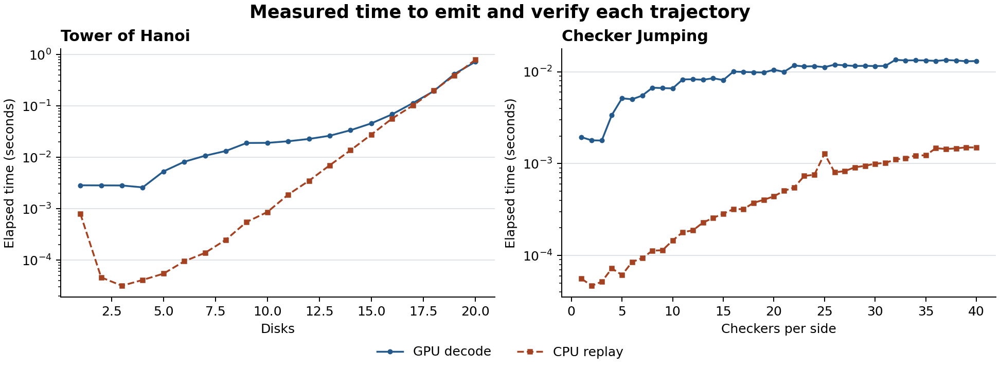

# Tower of Hanoi and Checker Jumping

**60/60 trajectories** ended with the end-of-sequence token, reached the goal legally and used the minimum number of moves. The held-out sizes accounted for 51/51 optimal trajectories. Independent simulators replayed 2,120,910 legal moves out of 2,120,910 emitted on Tesla T4. [Private Kaggle run, version 1](https://www.kaggle.com/code/ajayasaithambi/loopedwsp-sequential-puzzles/versions/1)

## Model and timing summary

| Puzzle | Dense parameters | Nonzero | Base loops | GPU decode (s) | CPU replay (s) | Wall with stability and replay (s) |
|---|---:|---:|---:|---:|---:|---:|
| Tower of Hanoi | 11,062 | 966 | 2 | 1.755429 | 1.596829 | 4.151504 |
| Checker Jumping | 13,233 | 1,362 | 2 | 0.381444 | 0.025292 | 0.599536 |

Across all sizes, FP64 decoding took 2.136873 s and independent CPU replay took 1.622122 s. The sum of measured per-size wall times was 4.751041 s, including the additional prediction checks at twice and four times the base loop count. Across emitted positions and EOS, 0 predictions changed at either checkpoint. The wall-time measurement starts with each size’s decode and ends after replay. Kaggle startup, model setup, development parity checks and writing the archives are outside it.

Each point is a single measured trajectory. The per-size tables show seconds to six decimal places. The CSV retains the precision reported by the evaluator. [Download the size-level CSV](sizes.csv)

## How moves were decoded

Each model receives one size prompt. A move position supplies a role and numeric features of its index. A check on the frozen query and key tensors establishes that their routing coordinates remain constant through the loops. The unique prompt wins causal attention by a margin large enough that all other FP64 softmax weights round to zero. Consequently, several output positions can be evaluated together using the prompt and their individual indices. The GPU decoder evaluates windows of up to 4,096 positions and retains moves up to the first predicted EOS. It can evaluate additional positions in the final window.

The development check decoded the full causal prefix one move at a time and compared its trajectory with the windowed decoder. The study’s transformers use move history during decoding. The timings here measure these independent position-based models. [LoopedWSP study, Appendix E](https://mbzuai-oryx.github.io/LoopedWSP/)

For Checker Jumping, the size embedding explicitly supplies the analytic quantity N(N+2) as well as N. The network uses the supplied length to locate its forward and reflected movement phases and predict EOS. The checker simulator reconstructs the board, checks every slide and jump, and compares the final board and emitted move count with the optimum. Each red checker must cross each blue checker once, requiring N² jumps. The two groups travel a combined 2N(N+1) slots. After the jumps, 2N single-slot slides remain, giving N(N+2) total moves. The Hanoi simulator checks the disk and both pegs on each move. Moving the largest disk requires moving the smaller tower out of the way and then onto it, giving the minimum 2ᴺ−1. [Puzzle definitions and simulator rules](https://arxiv.org/html/2506.06941v1#A1.SS1)

## Tower of Hanoi by size

| Disks | Range | Emitted / optimum | Legal moves | Goal | Optimal | GPU decode (s) | CPU replay (s) |
|---:|---|---:|---:|---|---|---:|---:|
| 1 | development | 1 / 1 | 1 | Yes | Yes | 0.002858 | 0.000799 |
| 2 | development | 3 / 3 | 3 | Yes | Yes | 0.002846 | 0.000046 |
| 3 | development | 7 / 7 | 7 | Yes | Yes | 0.002836 | 0.000032 |
| 4 | development | 15 / 15 | 15 | Yes | Yes | 0.002604 | 0.000041 |
| 5 | development | 31 / 31 | 31 | Yes | Yes | 0.005328 | 0.000055 |
| 6 | development | 63 / 63 | 63 | Yes | Yes | 0.008212 | 0.000095 |
| 7 | held out | 127 / 127 | 127 | Yes | Yes | 0.010746 | 0.000138 |
| 8 | held out | 255 / 255 | 255 | Yes | Yes | 0.013313 | 0.000249 |
| 9 | held out | 511 / 511 | 511 | Yes | Yes | 0.019041 | 0.000552 |
| 10 | held out | 1,023 / 1,023 | 1,023 | Yes | Yes | 0.019139 | 0.000863 |
| 11 | held out | 2,047 / 2,047 | 2,047 | Yes | Yes | 0.020565 | 0.001885 |
| 12 | held out | 4,095 / 4,095 | 4,095 | Yes | Yes | 0.022814 | 0.003502 |
| 13 | held out | 8,191 / 8,191 | 8,191 | Yes | Yes | 0.026349 | 0.007020 |
| 14 | held out | 16,383 / 16,383 | 16,383 | Yes | Yes | 0.033739 | 0.013761 |
| 15 | held out | 32,767 / 32,767 | 32,767 | Yes | Yes | 0.045848 | 0.027765 |
| 16 | held out | 65,535 / 65,535 | 65,535 | Yes | Yes | 0.068747 | 0.056923 |
| 17 | held out | 131,071 / 131,071 | 131,071 | Yes | Yes | 0.113847 | 0.102156 |
| 18 | held out | 262,143 / 262,143 | 262,143 | Yes | Yes | 0.193954 | 0.199328 |
| 19 | held out | 524,287 / 524,287 | 524,287 | Yes | Yes | 0.419262 | 0.392279 |
| 20 | held out | 1,048,575 / 1,048,575 | 1,048,575 | Yes | Yes | 0.723382 | 0.789339 |

## Checker Jumping by size

| Checkers per side | Range | Emitted / optimum | Legal moves | Goal | Optimal | GPU decode (s) | CPU replay (s) |
|---:|---|---:|---:|---|---|---:|---:|
| 1 | development | 3 / 3 | 3 | Yes | Yes | 0.001942 | 0.000056 |
| 2 | development | 8 / 8 | 8 | Yes | Yes | 0.001795 | 0.000047 |
| 3 | development | 15 / 15 | 15 | Yes | Yes | 0.001785 | 0.000052 |
| 4 | held out | 24 / 24 | 24 | Yes | Yes | 0.003391 | 0.000072 |
| 5 | held out | 35 / 35 | 35 | Yes | Yes | 0.005146 | 0.000061 |
| 6 | held out | 48 / 48 | 48 | Yes | Yes | 0.005020 | 0.000085 |
| 7 | held out | 63 / 63 | 63 | Yes | Yes | 0.005511 | 0.000094 |
| 8 | held out | 80 / 80 | 80 | Yes | Yes | 0.006709 | 0.000113 |
| 9 | held out | 99 / 99 | 99 | Yes | Yes | 0.006651 | 0.000114 |
| 10 | held out | 120 / 120 | 120 | Yes | Yes | 0.006598 | 0.000146 |
| 11 | held out | 143 / 143 | 143 | Yes | Yes | 0.008262 | 0.000180 |
| 12 | held out | 168 / 168 | 168 | Yes | Yes | 0.008294 | 0.000188 |
| 13 | held out | 195 / 195 | 195 | Yes | Yes | 0.008191 | 0.000229 |
| 14 | held out | 224 / 224 | 224 | Yes | Yes | 0.008505 | 0.000257 |
| 15 | held out | 255 / 255 | 255 | Yes | Yes | 0.008124 | 0.000286 |
| 16 | held out | 288 / 288 | 288 | Yes | Yes | 0.010044 | 0.000320 |
| 17 | held out | 323 / 323 | 323 | Yes | Yes | 0.009962 | 0.000320 |
| 18 | held out | 360 / 360 | 360 | Yes | Yes | 0.009889 | 0.000375 |
| 19 | held out | 399 / 399 | 399 | Yes | Yes | 0.009822 | 0.000404 |
| 20 | held out | 440 / 440 | 440 | Yes | Yes | 0.010523 | 0.000441 |
| 21 | held out | 483 / 483 | 483 | Yes | Yes | 0.009993 | 0.000506 |
| 22 | held out | 528 / 528 | 528 | Yes | Yes | 0.011719 | 0.000551 |
| 23 | held out | 575 / 575 | 575 | Yes | Yes | 0.011436 | 0.000735 |
| 24 | held out | 624 / 624 | 624 | Yes | Yes | 0.011512 | 0.000758 |
| 25 | held out | 675 / 675 | 675 | Yes | Yes | 0.011235 | 0.001283 |
| 26 | held out | 728 / 728 | 728 | Yes | Yes | 0.011962 | 0.000804 |
| 27 | held out | 783 / 783 | 783 | Yes | Yes | 0.011760 | 0.000830 |
| 28 | held out | 840 / 840 | 840 | Yes | Yes | 0.011564 | 0.000913 |
| 29 | held out | 899 / 899 | 899 | Yes | Yes | 0.011614 | 0.000947 |
| 30 | held out | 960 / 960 | 960 | Yes | Yes | 0.011539 | 0.000999 |
| 31 | held out | 1,023 / 1,023 | 1,023 | Yes | Yes | 0.011586 | 0.001019 |
| 32 | held out | 1,088 / 1,088 | 1,088 | Yes | Yes | 0.013487 | 0.001109 |
| 33 | held out | 1,155 / 1,155 | 1,155 | Yes | Yes | 0.013307 | 0.001150 |
| 34 | held out | 1,224 / 1,224 | 1,224 | Yes | Yes | 0.013333 | 0.001225 |
| 35 | held out | 1,295 / 1,295 | 1,295 | Yes | Yes | 0.013299 | 0.001233 |
| 36 | held out | 1,368 / 1,368 | 1,368 | Yes | Yes | 0.013136 | 0.001474 |
| 37 | held out | 1,443 / 1,443 | 1,443 | Yes | Yes | 0.013417 | 0.001445 |
| 38 | held out | 1,520 / 1,520 | 1,520 | Yes | Yes | 0.013274 | 0.001467 |
| 39 | held out | 1,599 / 1,599 | 1,599 | Yes | Yes | 0.013017 | 0.001505 |
| 40 | held out | 1,680 / 1,680 | 1,680 | Yes | Yes | 0.013087 | 0.001499 |

## Source artifacts

- **Tower of Hanoi** — [Kaggle results](<../../kaggle/runs/sequential-puzzles/v1/output/puzzle-hanoi.json>) · [Emitted move IDs](<../../kaggle/runs/sequential-puzzles/v1/output/emitted-hanoi.npz>) · [Move alphabet](<../../puzzles/models/hanoi/network.json>) · [Frozen weights](<../../puzzles/models/hanoi/weights.npz>)
- **Checker Jumping** — [Kaggle results](<../../kaggle/runs/sequential-puzzles/v1/output/puzzle-checkers.json>) · [Emitted move IDs](<../../kaggle/runs/sequential-puzzles/v1/output/emitted-checkers.npz>) · [Move alphabet](<../../puzzles/models/checkers/network.json>) · [Frozen weights](<../../puzzles/models/checkers/weights.npz>)

[Evaluation harness](<../../puzzles/experiment.py>) · [Decoder](<../../puzzles/frame.py>) · [Independent verifiers](<../../puzzles/verify.py>) · [Kaggle submission receipt](<../../kaggle/runs/sequential-puzzles/v1/submission.json>) · [Remote verification record](<../../kaggle/runs/sequential-puzzles/v1/verification.json>) · [Second replay of downloaded moves](<replay-audit.json>)
