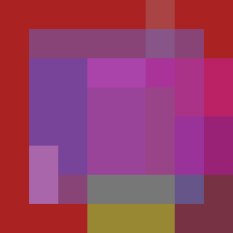

# Balancing mobiles, layering animation cels and repairing punched music rolls

On a Kaggle Tesla T4, three weight-programmed transformers matched **768/768 complete outputs** and **53,248/53,248 individual labels**. Sizes above the development range accounted for 384/384 exact records.

A whole record counts when its counterweight answer, all 192 output color channels or every note and repair status agrees with the independent reference. The sizes count ornaments, animation layers or roll frames respectively.

| Application | Size | Stored scalars | Exact records | Correct labels | Median ms |
| --- | --- | ---: | ---: | ---: | ---: |
| Kinetic mobile | 4 ornaments | 7 | 64/64 | 64/64 | 9.13 |
| Kinetic mobile | 8 ornaments | 7 | 64/64 | 64/64 | 12.61 |
| Kinetic mobile | 16 ornaments | 7 | 64/64 | 64/64 | 16.30 |
| Kinetic mobile | 32 ornaments | 7 | 64/64 | 64/64 | 19.58 |
| Animation cels | 4 layers | 64 | 64/64 | 12,288/12,288 | 16.63 |
| Animation cels | 8 layers | 64 | 64/64 | 12,288/12,288 | 30.15 |
| Animation cels | 16 layers | 64 | 64/64 | 12,288/12,288 | 49.56 |
| Animation cels | 32 layers | 64 | 64/64 | 12,288/12,288 | 90.52 |
| Punched music roll | 4 frames | 1,342 | 64/64 | 256/256 | 9.44 |
| Punched music roll | 8 frames | 1,342 | 64/64 | 512/512 | 9.67 |
| Punched music roll | 16 frames | 1,342 | 64/64 | 1,024/1,024 | 8.67 |
| Punched music roll | 32 frames | 1,342 | 64/64 | 2,048/2,048 | 9.73 |

Each time is the median of 3 synchronized forward runs over 64 pre-encoded GPU-resident records in batches of 8, after a warm-up. Each model reused its programmed FP32 tensors. Counts include stored zeros and exclude fixed geometry, operations and working memory. [All timing repeats](sizes.csv)

## Cases that distinguish the tasks

- **Mobile.** The GPU matched 128/128 feasible designs and 128/128 infeasible designs. A check at just the missing ornament’s parent would accept 64 of the infeasible designs. The GPU rejected 64 of those.
- **Animation.** Reversing the cel order changes the reference image in 240 stacks. The model matched the original frame pixel-for-pixel on 240/240 of them.
- **Music roll.** Frame classifications matched on 1,504/1,504 undamaged frames, 1,466/1,466 single-hole repairs and 870/870 two-hole errors.

## Find the missing counterweight

Test record `mobile_4[0]` has four ornament masses `[27, ?, 5, 20]` grams, ordered left to right. The GPU predicted **1 g**. The integer oracle gives 1 g. With that mass, all three rods balance.

| Rod | Left torque | Right torque |
| --- | ---: | ---: |
| Lower left | 27 × 4 = 108 | 1 × 108 = 108 |
| Lower right | 5 × 8 = 40 | 20 × 2 = 40 |
| Root | 28 × 50 = 1400 | 25 × 56 = 1400 |

The model tests 16 integer counterweights in parallel. A shared block propagates subtree masses and torque errors up the complete binary tree. Every rod is horizontal and massless in this idealized tabletop model. The admissible missing mass is 1–16 g.

## See the rendered animation frame



Each square represents one of the 8 × 8 original pixels. In test record `cels_8[20]`, pixel (x=5, y=6) was `[9, 8, 3]` before cel 7 applied a half-opacity `[5, 6, 11]` tint. The GPU returned `[7, 7, 7]` there. The PNG scales each four-bit channel by 17 for display.

Each step attends to the next cel at each pixel and applies its opacity. The canvas stays 8 × 8 at all test sizes as the stack grows from four to 32 layers. It uses an opaque background and 16 levels per RGB channel. Cels are solid axis-aligned rectangles with opacity 0, ½ or 1. Half-integer blends round upward after each layer.

## Hear a recovered punched roll

The WAV synthesizes the 16 GPU-decoded beats in test record `roll_16[7]`. Rests and uncorrectable beats are silent. The class IDs distinguish the two. [Listen to the decoded roll](recovered.wav)

These are the first eight observed track patterns and their predictions.

| Beat | Observed holes | GPU event | GPU status |
| ---: | --- | --- | --- |
| 1 | `01101110` | A5 | corrected track 5 |
| 2 | `01111001` | E4 | corrected track 8 |
| 3 | `00100101` | B4 | corrected track 5 |
| 4 | `01011011` | E5 | corrected track 4 |
| 5 | `00110011` | D5 | clean |
| 6 | `11111011` | C6 | corrected track 6 |
| 7 | `10101010` | F5 | clean |
| 8 | `10110100` | G4 | clean |

This synthetic format encodes a rest or one of 15 pitches in each eight-hole frame. The block reduces parity checks in three passes. Extended Hamming parity identifies a single changed hole and flags a two-hole change. The repair guarantee covers at most two changed holes per frame. Each frame is processed independently. Development checks covered all 256 possible observed patterns across 592 combinations of original events and zero, one or two changed holes. Longer held-out rolls test complete sequences formed from new combinations of these familiar patterns.

## Evidence and reproduction

[Models and input formats](../../workshop/README.md) · [Frozen inputs and weights](../../workshop/freeze.json) · [GPU predictions](../../kaggle/runs/workshop/v1/output/workshop-predictions.npz) · [Kaggle verification](../../kaggle/runs/workshop/v1/verification.json) · [Private Kaggle version](https://www.kaggle.com/code/ajayasaithambi/loopedwsp-workshop-applications/versions/1) · [Independent audit](audit.json)

From the repository root, run the audit to recompute the targets. The report command regenerates the tables, preview and audio.

```sh
python workshop/audit.py kaggle/runs/workshop/v1 audit-output/workshop-audit.json
python workshop/report.py kaggle/runs/workshop/v1 results/workshop
```
